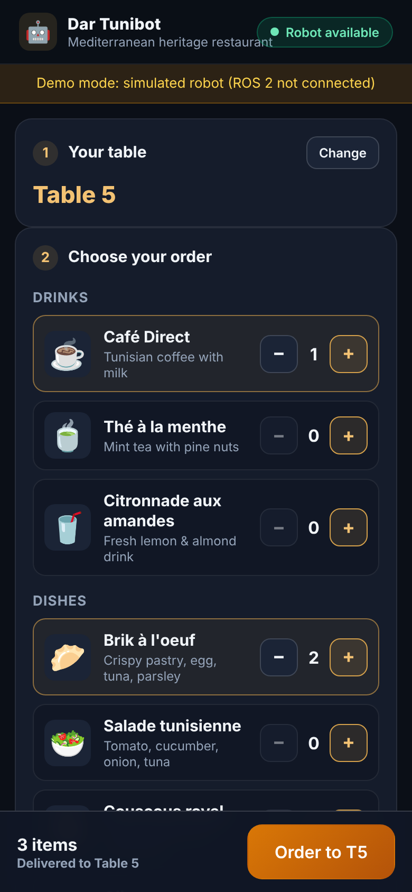
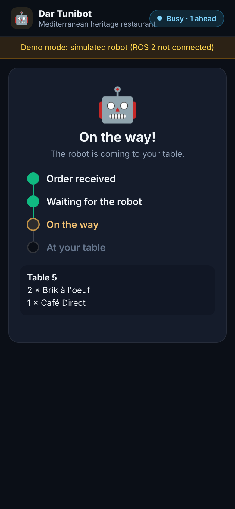
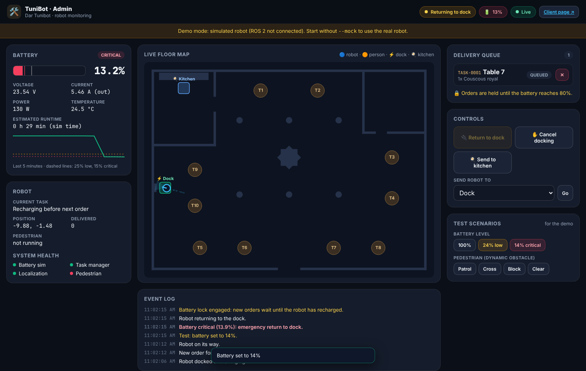
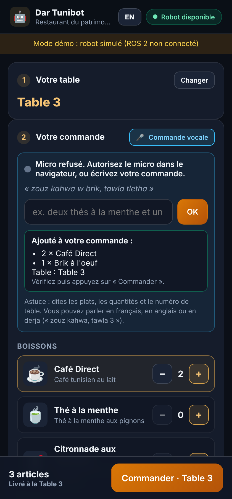
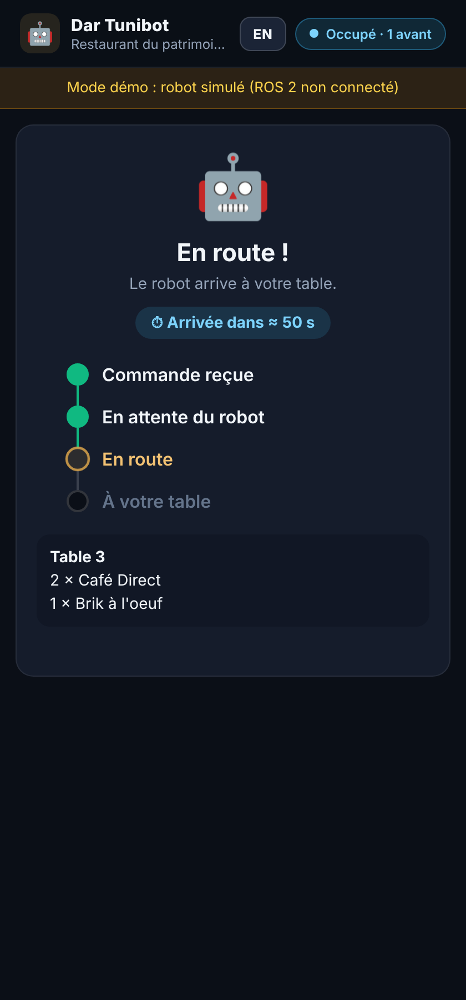

# Autonomous Waiter Service Robot for Indoor Delivery (CSTAM-TUNIBOT)

A complete ROS 2 autonomous navigation and delivery orchestration stack developed for indoor restaurant and hospitality environments.

The system integrates 3D Gazebo simulation (Harmonic), a BellaBot differential-drive robot model with LiDAR and wheel odometry, AMCL localization, Nav2 autonomous navigation, a dynamic delivery task queue manager, automatic return-to-dock behaviors, physical battery simulation with low-battery return-to-dock, dynamic obstacle avoidance with pedestrian tracking, and a native Mission Control Simulator interface (GUI and CLI).

---

## 📌 System Architecture Overview

```
                      +-----------------------------------+
                      |   Mission Control Simulator UI    |
                      |   (delivery_simulator_ui.py)      |
                      +-----------------+-----------------+
                                        |  /delivery_request
                                        |  /delivery_task_action
                                        |  /dock_command
                                        v
+-----------------------+     +-------------------+     +-----------------------+
|  Auto-Docking Node    | --> | Delivery Task     | --> | Nav2 Navigation Stack |
| (docking_controller)  |     | Manager Node      |     | (Planner, Controller, |
+-----------------------+     | (TaskQueueManager)|     |  Recoveries, BT)      |
            ^                 +---------+---------+     +-----------+-----------+
            |                           |                           |
     /battery_state                     v                           v
     /battery_status              /dock_state                   /cmd_vel
            |                     /delivery_queue_status            |
+-----------+-----------+         /robot_system_state               v
|   Battery Simulator   |                               +-----------------------+
| (24V 20Ah Li-ion NMC) |                               | Gazebo Simulation     |
+-----------------------+                               | - BellaBot Robot Base |
                                                        | - Dynamic Obstacle    |
+-----------------------+                               | - 2D LiDAR (/scan)    |
| Dynamic Obstacle Ctrl | ----------------------------> | - AMCL Localization   |
| (Patrol, Cross, Block)|   /dynamic_obstacle/cmd_vel   +-----------------------+
+-----------------------+
```

---

## 🌟 Phase 2 Features: Integration & Testing

### 1. Dynamic Obstacle Avoidance [10 Points]
- **Real-Time Moving Obstacle Response**: Cylindrical collision model ($r = 0.25\,\text{m}$, $h = 1.70\,\text{m}$) detectable by 2D planar LiDAR at $z = 0.20\,\text{m}$.
- **Reactive Safety Stopping & Yielding**: When a human crosses into the robot's clearance corridor ($< 0.70\,\text{m}$), the robot smoothly decelerates and halts without contact until the path is cleared.
- **Dynamic Obstacle Controller**: Operates in `PATROL`, `CROSS`, `BLOCK`, and `CLEAR` modes with 3D RViz radar visual markers (`/dynamic_obstacle/markers`).
- **High-Rate Local Costmap**: Configured at 10 Hz with raytrace clearing (5.0m) to track moving obstacles with minimal latency.

### 2. Complex Layout Handling [10 Points]
- **Narrow Corridors & Doorways**: Tested in **Dar Tunibot** (`resto_arbi.world`) featuring authentic 1.20m arched doorways and narrow dining aisles.
- **Calibrated Costmap Inflation**: Robot radius $0.28\,\text{m}$, inflation radius $0.42\,\text{m}$ (reduced from 0.55m), and cost scaling factor $4.5$ to eliminate artificial doorway blockage while guaranteeing safe clearance.
- **Multi-Stage Recovery Maneuvers**: Automated costmap clearing, reverse retreat maneuver ($v_x = -0.15\,\text{m/s}$ for 1.8s), replanning, and queue order preservation upon failure.

### 3. Battery & State Simulation [10 Points]
- **Physical Li-ion NMC Model**: 24V 20Ah pack ($480\,\text{Wh}$) with non-linear open-circuit voltage discharge curve ($21.0\,\text{V} - 29.4\,\text{V}$), Coulomb counting, and thermal modeling.
- **Dynamic Voltage Sag**: Idle load $35\,\text{W}$ vs. cruising load $\approx 130\,\text{W}$ under internal resistance $R_{\text{int}} = 0.045\,\Omega$.
- **Autonomous Return-To-Dock Policy**:
  - **Low Battery ($\le 25\%$)**: Triggers autonomous return to dock when queue completes; blocks preemption until recharged.
  - **Critical Battery ($\le 15\%$)**: Emergency docking override that immediately aborts active navigation to preserve pack longevity.
  - **Recharge Hysteresis ($\ge 80\%$)**: Enforces minimum recharge threshold before undocking or accepting new missions.

---

## 🖥️ Phase 3: Web Interface (Client + Admin)

A web interface served by the new ROS 2 package `cstam_web`. It only relays the topics the robot already publishes (task manager, battery simulator, AMCL/Nav2, pedestrian), so the UI always shows the real robot state.

| Page | URL | For |
|------|-----|-----|
| Client | `http://<PC-IP>:8000/` (or `/?table=5` from a table QR code) | Guests: pick a table and dishes (by tapping or **by voice**), then follow the delivery live (queued → on the way → at your table → delivered, with an arrival estimate), cancel while still queued. French / English. |
| Admin | `http://<PC-IP>:8000/admin` | Staff: live floor map with the Nav2 path, battery gauge and 5-minute history, queue with cancel, return-to-dock, system health, event log, and test buttons (low/critical battery, pedestrian modes) |

<p>
  
</p>

**🎤 Voice orders (bonus feature).** Tap the microphone and say for example *« deux thés à la menthe et un brik pour la table 4 »*, *"two coffees and a couscous, table seven"* or, in derja, *« zouz kahwa w brik, tawla tletha »*. The browser turns speech into text (Web Speech API, Chrome / Edge) and `cstam_web/voice.py` matches dishes, quantities and the table against the menu. The cart is filled and read back aloud; the guest confirms with the Order button. A text box does the same when no microphone is available.
Browsers only allow the microphone on `http://localhost` or HTTPS: use the PC's own browser for the voice demo, or on a phone enable `chrome://flags/#unsafely-treat-insecure-origin-as-secure` for `http://<PC-IP>:8000`.

<p>
 
</p>

**Run it**

```bash
pip install -r requirements.txt               # fastapi + uvicorn[standard]
cd ros2_ws && colcon build --symlink-install && source install/setup.bash && cd ..

./run_autonomous_system.sh                    # terminal 1: robot (Gazebo, Nav2, core nodes)
./run_web_interface.sh                        # terminal 2: web interface on port 8000
./run_web_interface.sh --mock --world resto_arbi   # or: demo mode without ROS 2 / Gazebo
```

Phones on the same Wi-Fi can open the client page with the PC's IP address.

**Tests:** `python3 -m pytest ros2_ws/src/cstam_web/test` runs the API, order tracking and voice parser tests, plus a browser end-to-end test (voice order → simulated robot → "Delivered") when Playwright is installed (`pip install playwright && playwright install chromium`).

---

## 🚀 Quick Start Guide

### 1. Prerequisites & Environment Setup

Ensure ROS 2 Jazzy and Gazebo Sim dependencies are installed and sourced:

```bash
source /opt/ros/jazzy/setup.bash
cd ~/cstan_tunibot
source ros2_ws/install/setup.bash
```

If you need to rebuild the workspace packages:

```bash
cd ros2_ws
colcon build --symlink-install
source install/setup.bash
cd ..
```

---

### 2. Running the System

#### Terminal 1: Launch the Autonomous Robot Simulation
Launch 3D Gazebo, BellaBot, Dynamic Human Obstacle, AMCL localization, Nav2 path planning, and RViz2:

```bash
./run_autonomous_system.sh
```

> **Environment Selection:**  
> By default, the system launches the **Restaurant Lounge** (`restaurant.world`, 24 dining tables).  
> To launch **Dar Tunibot** (`resto_arbi.world`, 10 dining tables, complex narrow doorways):
> ```bash
> ./run_autonomous_system.sh world:=resto_arbi.world
> ```

#### Terminal 2: Launch the Mission Control Simulator Dashboard
Open the native operator interface with live battery gauges, obstacle radar, and queue manager:

```bash
./run_delivery_simulator.sh
```

> **Headless / Remote SSH Mode:**  
> If running without a graphical display, run in interactive CLI mode:
> ```bash
> ./run_delivery_simulator.sh --cli
> ```

---

### 3. Running Automated System Verification

Run the complete verification suite locally:

```bash
# Phase 1 & Core Unit Tests (9 Tests)
python3 test_system.py

# Phase 2 Live Multi-Node Integration Tests (5 Tests)
python3 test_system_phase2.py
```

---

### 4. Screen-Recorded Demonstration Video

The demonstration video showing real-time dynamic obstacle avoidance is available at:
- **Video Path**: [`docs/dynamic_obstacle_avoidance_demo.mp4`](file:///home/wass/cstan_tunibot/docs/dynamic_obstacle_avoidance_demo.mp4) (720p HD, 24 FPS, 480 frames)
- **Regenerate Video**: `python3 record_dynamic_obstacle_demo.py`

---

## 📖 How to Use the System

### 1. Placing Delivery Orders
1. In the **Order Dispatcher** panel on the left:
   - Select a destination table from the dropdown menu (e.g., `Table 1`, `Table 5`, or `Kitchen/Pickup`).
   - Enter a food/drink description or click one of the quick menu presets (e.g. *Espresso & Croissant*, *Chef's Pasta Carbonara*).
2. Click **🚀 Dispatch Order to Robot**.
3. If the robot is currently idle or docked (and battery $\ge 25\%$), it immediately pops the order, switches state to `NAVIGATING`, and plans a collision-free route to the service point facing that table.
4. If orders are already in progress, the new request enters the **Pending Tasks** FIFO queue.

### 2. Managing the Live Delivery Queue
The **Live Delivery Queue & Monitoring** panel displays active and queued tasks:
- **Real-Time Modification**: Click any queued task in the pending listbox. The order details load into the inputs. Edit the target table or item description, then click **💾 Save Edit**. The task is dynamically updated in the manager without stopping the robot.
- **Task Deletion**: Select an order from the queue and click **🗑️ Delete Task** to remove it from the schedule.
- **Service Completion**: Upon arriving within range of the table, the robot enters `AT_TABLE` state, dwells for a handover period (simulating meal delivery), marks the task completed, and automatically pops the next delivery.

### 3. Auto-Docking and Resting Behavior
- **Autonomous Return-To-Dock**: When the delivery queue is empty and the robot has been idle for the timeout period (10 seconds), the auto-docking controller automatically commands the robot to navigate back to the resting dock station.
- **Manual Docking Control**: Click **⚓ Return-To-Dock** at any time to send the robot to the dock.
- **Emergency / Manual Stop**: Click **🛑 Stop Docking** to immediately halt the robot base and return the state to `IDLE`.
- **Battery-Protective Docking**: When battery is $< 25\%$ (low) or $< 15\%$ (critical), the robot docks and locks out new orders until recharged to $\ge 80\%$.

---

## 🍽️ Restaurant Layout & Predefined Waypoints

### Grand Promenade (`restaurant.world`)
Features **24 Dining Tables**, a **Kitchen Pickup Counter**, and a Southeast **Resting Dock**:

| Service Zone | Waypoints | Description |
| :--- | :--- | :--- |
| **Resting Dock Station** | `Dock` | Southeast corner resting dock & staging zone `(7.06, -12.00)` |
| **Kitchen / Pickup** | `Kitchen/Pickup` | West central counter for food/drink pickup `(-9.60, -1.39)` |
| **North Terrace** | `Table 0` .. `Table 5` | Dining tables along northern service aisle ($y = 0.50$) |
| **Mid Lounge** | `Table 6` .. `Table 11` | Dining tables along main central promenade ($y = -3.10$) |
| **Central Salon** | `Table 12` .. `Table 17` | Dining tables facing southern walkway ($y = -5.85$) |
| **South Wing** | `Table 18` .. `Table 23` | Dining tables along southern service aisle ($y = -9.45$) |

All waypoint coordinates and orientations are configured in [`ros2_ws/src/cstam_navigation/config/waypoints.yaml`](file:///home/wass/cstan_tunibot/ros2_ws/src/cstam_navigation/config/waypoints.yaml).

### Dar Tunibot (`resto_arbi.world`)
Features **10 Dining Tables**, a **North Wing Kitchen**, narrow 1.20m stone doorways, and a West Wall **Resting Dock**:
- Configured in [`ros2_ws/src/cstam_navigation/config/resto_arbi_waypoints.yaml`](file:///home/wass/cstan_tunibot/ros2_ws/src/cstam_navigation/config/resto_arbi_waypoints.yaml).

---

## 📡 ROS 2 Communication Architecture

| Topic / Action Name | Type | Direction | Description |
| :--- | :--- | :--- | :--- |
| `/delivery_request` | `std_msgs/msg/String` (JSON) | Simulator $\rightarrow$ Task Manager | Submits new delivery orders (`{"target": "...", "item": "..."}`) |
| `/delivery_task_action` | `std_msgs/msg/String` (JSON) | Simulator $\rightarrow$ Task Manager | Queue operations (`{"action": "modify"\|"delete"\|"stop_dock", ...}`) |
| `/dock_command` | `std_msgs/msg/String` | Controller / UI $\rightarrow$ Task Manager | Commands return to dock (`"DOCK_NOW:..."`) or halt (`"STOP_DOCK"`) |
| `/dock_state` | `std_msgs/msg/Bool` | Task Manager $\rightarrow$ Simulator / Ctrl | Real-time dock status (`true` = docked, `false` = undocked) |
| `/delivery_queue_status` | `std_msgs/msg/String` (JSON) | Task Manager $\rightarrow$ Simulator / Ctrl | Live queue status, current task, pending orders, and completed count |
| `/robot_system_state` | `std_msgs/msg/String` | Task Manager $\rightarrow$ Simulator | Current state (`IDLE`, `NAVIGATING`, `AT_TABLE`, `DOCKING`, `DOCKED`) |
| `/navigate_to_pose` | `nav2_msgs/action/NavigateToPose` | Task Manager $\rightarrow$ Nav2 | Action interface dispatching target waypoints to Nav2 planner |
| `/cmd_vel` | `geometry_msgs/msg/Twist` | Nav2 / Task Manager $\rightarrow$ Diff-Drive | Mobile base velocity commands and braking |
| `/scan` | `sensor_msgs/msg/LaserScan` | LiDAR $\rightarrow$ Nav2 / AMCL | 2D LiDAR range data for obstacle avoidance and localization |
| `/battery_state` | `sensor_msgs/msg/BatteryState` | Simulator $\rightarrow$ Controller / UI | Standard ROS 2 battery telemetry (voltage, percentage, current) |
| `/battery_status` | `std_msgs/msg/String` (JSON) | Simulator $\rightarrow$ Controller / UI | Extended battery status (power, temperature, charging state) |
| `/dynamic_obstacle/cmd_vel` | `geometry_msgs/msg/Twist` | Controller $\rightarrow$ Gazebo | Velocity commands driving the walking human obstacle |
| `/dynamic_obstacle/odom` | `nav_msgs/msg/Odometry` | Gazebo $\rightarrow$ Controller | Odometry feedback for dynamic obstacle positioning |
| `/dynamic_obstacle/status` | `std_msgs/msg/String` (JSON) | Controller $\rightarrow$ UI / Monitor | Dynamic obstacle mode, position, and radar threat status |
| `/dynamic_obstacle/markers` | `visualization_msgs/msg/MarkerArray` | Controller $\rightarrow$ RViz2 | 3D visual markers displaying pedestrian torso and safety zone |

---

## 📁 Repository Structure

```
cstan_tunibot/
├── delivery_simulator_ui.py          # Native Mission Control Simulator (Tkinter GUI & CLI)
├── record_dynamic_obstacle_demo.py   # Demonstration video generator
├── run_autonomous_system.sh          # Master launch script (Gazebo + Nav2 + AMCL + RViz2 + Core)
├── run_delivery_simulator.sh         # Launch script for Delivery Simulator Interface
├── run_mapping_demo.sh               # SLAM mapping demonstration launch script
├── save_map.sh                       # Utility script to export active SLAM map
├── test_system.py                    # Automated Phase 1 & core unit test suite
├── test_system_phase2.py             # Automated Phase 2 live multi-node integration test suite
├── docs/
│   ├── CSTAM-BOOK.pdf                # Technical manual and reference documentation
│   ├── README.md                     # Documentation guide
│   ├── phase2-test-report.md         # Comprehensive Phase 2 test case documentation
│   └── dynamic_obstacle_avoidance_demo.mp4 # Screen-recorded obstacle avoidance demo video
└── ros2_ws/
    └── src/
        ├── cstam_core/               # Task Manager, Docking Controller, Battery & Obstacle Simulators
        ├── cstam_gazebo/             # 3D Gazebo worlds, BellaBot & Dynamic Obstacle models
        └── cstam_navigation/         # Nav2 configuration, AMCL parameters, maps, and waypoints
```
